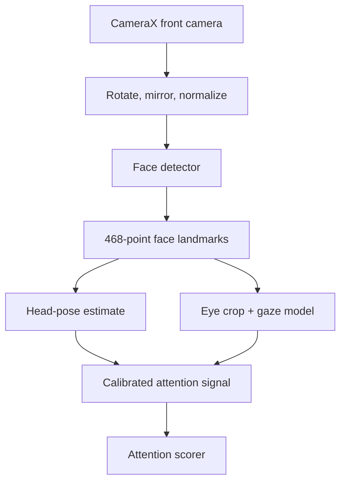
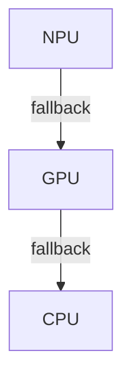
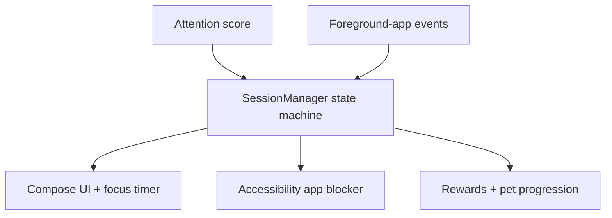

# FocusGuard

FocusGuard is an Android study app that protects a focus session with fully on-device attention sensing. A three-model LiteRT pipeline estimates face presence, head pose, and eye state; the session state machine pauses distracted time; and an Accessibility Service blocks selected apps until the student returns.

Camera frames used for attention detection remain on the device, and the core focus flow does not require a network connection.

## At a glance

| | |
|---|---|
| **Problem** | Help students stay focused during study sessions by detecting distraction and pausing the timer until they return |
| **ML pipeline** | Face detection → 468-point landmarks → eye/gaze estimation → calibrated attention score |
| **Runtime** | Google LiteRT with automatic NPU → GPU → CPU fallback |
| **Measured result** | Threshold tuning reduced training-set false negatives from 116 to 57; held-out rolling-window agreement reached 92.7% |
| **Stack** | Kotlin, Jetpack Compose, CameraX, LiteRT, Coroutines, DataStore |
| **Privacy boundary** | Inference and calibration run locally; optional social data is separate in Supabase |

## System architecture

### On-device inference



Each model attempts the fastest available delegate and falls back safely:



### Product control loop



## Engineering highlights

### A pipeline designed for mobile failure modes

The app ships three frozen `.tflite` assets:

- `face_detector.tflite` finds the face and returns confidence and bounds;
- `face_landmark_detector.tflite` produces 468 landmarks for pose and eye geometry;
- `eyegaze.tflite` estimates gaze pitch and yaw from the eye crop.

`FallbackCompiledModel` attempts NPU, GPU, and CPU execution in order. Fallback covers both model creation and inference: if an accelerator fails during `run(...)`, the wrapper recreates buffers on the next backend, rewrites the input, and retries. Reliability is favored over assuming that one delegate works across Android devices.

### Per-session calibration before classification

A fixed head-pose threshold was unfair when phone placement or a student's natural reading posture changed. FocusGuard therefore freezes the timer for the first 45 detected-face frames, averages the neutral yaw and pitch, and scores later observations relative to that baseline.

The final decision also fails closed on missing faces, low-confidence landmarks, unreliable eye signals, or closed eyes. Raw predictions are aggregated into a smoothed signal before scoring, so the product does not treat every camera frame as an independent decision.

### Explicit state instead of timer side effects

`SessionManager` owns the phases `Idle`, `FocusActive`, `RewardActive`, `Paused`, `Failed`, and `Complete`. Calibration time does not reduce the study timer; distracted time is recorded separately; and a completed session opens a bounded reward window.

This state boundary keeps camera inference, the countdown, app blocking, and UI rendering from independently deciding what the session means.

### Guarded app blocking

`FocusAccessibilityService` observes foreground-window changes only while a focus session is active. A blacklisted app returns the user to EarnedIt and records the attempt, but the service intentionally excludes:

- EarnedIt itself;
- Android system UI and settings;
- the emergency dialer;
- the reward window;
- duplicate rapid events from the same package.

The accessibility service is a powerful Android capability, so its scope is kept narrow and testable. Manual QA guidance lives in [`docs/accessibility-service-qa.md`](docs/accessibility-service-qa.md).

### Instrumentation built into the inference path

Debug builds can capture per-stage inference timing, p50/p95/p99 summaries, FPS, memory pressure, garbage collection, and thermal state. An opt-in quality mode samples frames with JSON sidecars containing confidences, pose, calibration offsets, eye geometry, and the final focus decision.

Those artifacts make performance or delegate changes testable against the same quality data instead of relying on visual inspection.

## Evaluation: tuning the decision rule, not the models

All three models remained frozen. The change was to the decision boundary above their outputs.

A six-minute scripted session produced 664 human-labeled frames with a 0.5-second transition buffer. The original symmetric rule rejected too much normal downward reading:

```kotlin
abs(yaw) < 20.0 && abs(pitch) < 15.0
```

Error analysis showed that 79% of false negatives failed only the pitch threshold; their median pitch was 17.3°. The tuned asymmetric rule became:

```kotlin
yaw in -25.0..20.0 && pitch in -15.0..18.0
```

| Metric | Original | Tuned |
|---|---:|---:|
| Overall frame agreement | 79.3% | **88.4%** |
| Focused recall | 73.4% | **86.9%** |
| Distraction recall | **96.6%** | 92.6% |
| False negatives | 116 | **57** |

On a held-out session:

- frame-level agreement was **84.5%**;
- rolling-window agreement was **92.7%**;
- look-down/look-right distraction recall was **98.4%**;
- reaction time was under one captured frame.

These figures validate one device/setup protocol, not universal attention detection. They are useful because they expose the tradeoff: fewer unfair pauses cost some distraction recall.

## User flow

1. Choose a pet, focus duration, and distracting apps.
2. Grant camera access and explicitly enable the accessibility service.
3. Position the phone near the study material.
4. Hold a normal study posture during the 45-frame calibration.
5. Study while the on-device pipeline updates the focus state.
6. If attention is lost, the timer pauses; if a blocked app opens, EarnedIt returns to the foreground.
7. Complete the focused duration to unlock the reward window and progression.

Optional social profiles and friend requests use Supabase. They are isolated from attention inference and show a configuration-needed state when no backend is configured.

## Build and run

### Requirements

- Android Studio Ladybug or newer
- JDK 17
- Android SDK 35
- A local Gradle installation; the launcher scripts are present, but the wrapper metadata is not currently tracked
- An ARM64 physical Android device with a front camera

```bash
git clone https://github.com/gabriel-xiong/FocusGuard.git
cd FocusGuard
```

Optional social configuration belongs in `local.properties`:

```properties
SUPABASE_URL=https://your-project.supabase.co
SUPABASE_ANON_KEY=your-anon-key
```

The project uses AndroidX but does not currently track a root `gradle.properties`. Pass the property explicitly for a clean command-line build:

```powershell
gradle "-Pandroid.useAndroidX=true" :app:compileDebugKotlin
gradle "-Pandroid.useAndroidX=true" "-Dorg.gradle.jvmargs=-Xmx2048m -XX:MaxMetaspaceSize=512m" :app:assembleDebug
gradle "-Pandroid.useAndroidX=true" "-Dorg.gradle.jvmargs=-Xmx2048m -XX:MaxMetaspaceSize=512m" :app:installDebug
```

On macOS or Linux, the same commands work without quoting the `-Pandroid.useAndroidX=true` argument. After installation, grant camera permission and enable **EarnedIt App Blocking** under Android Accessibility settings.

## Repository map

```text
app/src/main/
  assets/                         three LiteRT model files
  java/com/focusguard/
    ml/                           preprocessing, model wrappers, pose, and gaze
    session/                      calibration, scoring, and session state
    service/                      foreground-app accessibility service
    instrumentation/              latency, system metrics, and quality capture
    ui/                           Jetpack Compose screens
    pet/                          reward and progression system
    social/                       optional Supabase integration
docs/accessibility-service-qa.md  blocking-service test matrix
supabase/social_schema.sql        optional social schema
```

## Current limitations

- Accuracy depends on lighting, face visibility, device angle, and desk geometry.
- The reported validation is small and setup-specific; it does not establish demographic fairness or general population performance.
- Attention is inferred from observable pose and eye signals, not comprehension or learning.
- The app currently targets ARM64 and has been optimized around modern Snapdragon-class hardware.
- Accessibility-based blocking requires explicit user trust and can be disabled by the operating system or user.
- Reproducible wrapper metadata and a checked-in AndroidX Gradle property still need to be added.
- Release hardening still needs broader device coverage, automated UI tests, battery profiling, and a formal privacy policy.

## Project context

FocusGuard was built with Rayan Ahmed, Sanjiv Saravanan, and Sual Harun for the Google × Qualcomm Developer Hackathon. The strongest engineering contribution is the measurement loop around the product: capture signals, label failure cases, tune a transparent decision rule, validate it on held-out data, and preserve an accelerator fallback for real devices.
